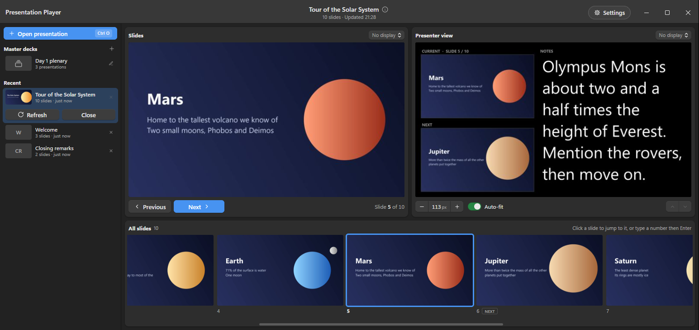
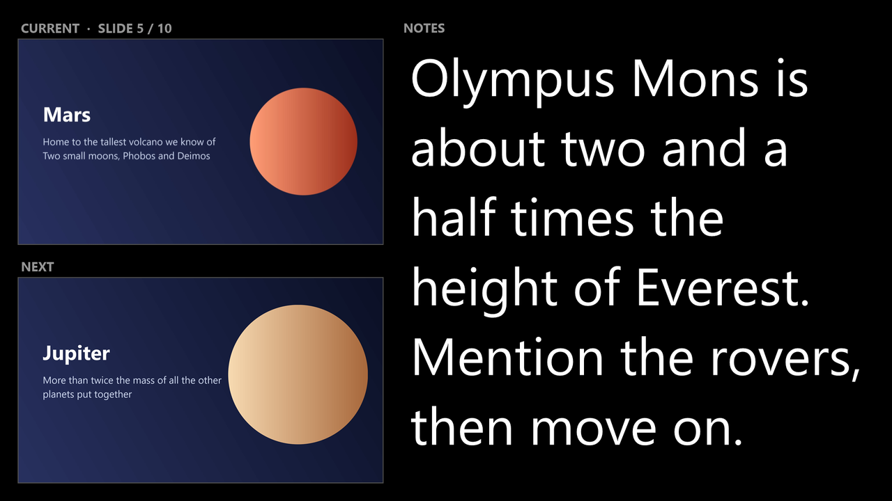
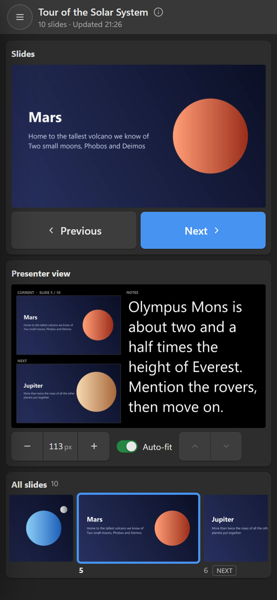
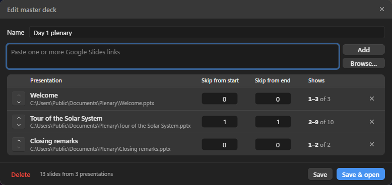

# Presentation Player

A Windows app for running presentations at events. It plays Google Slides decks (with their animations, transitions and video), PowerPoint files and PDFs, and gives you two outputs: the slides, and a presenter view with the current slide, next slide and speaker notes.

Both outputs go out over NDI, and can also be shown full screen on a display or in a window. You can run it from the app, the keyboard, a clicker, a phone on the same network, or [over HTTP](docs/http-api.md) from something like Companion.



**[Download the installer](https://github.com/internal-events-support/presentation-player/releases/latest/download/PresentationPlayer-Setup.exe)**

## Installing

You need:

- 64-bit Windows 11, or Windows 10 version 2004 or later
- the NDI 6 runtime, which comes with [NDI Tools](https://ndi.video/tools/)
- PowerPoint or [LibreOffice](https://www.libreoffice.org/), but only for PowerPoint files

Run the installer. It doesn't need an administrator, and installs the WebView2 runtime if you don't have it. Windows SmartScreen may warn you because the installer isn't code-signed.

If you have version 2.0.0 or earlier (the single exe), close it, run the installer and delete the old exe. Your settings and Google sign-in are kept, but Windows may ask about the firewall again.

To remove the app use Settings → Apps in Windows. Your settings and Google sign-in are left on the computer.

### Updates

The app looks for updates when it starts, and about every six hours while nothing is open. It downloads them in the background and installs them when you close it. To install one sooner, press Update in the top bar, and the app closes and reopens in a few seconds. It won't update while a second copy is open.

It never updates or restarts by itself while it's running, or as it starts, so if you have to reopen it during a show you get the same version. You can turn automatic updates off in Settings → Updates.

## Using it

Paste a Google Slides link (the normal `docs.google.com/presentation/d/.../edit` one) and press Open. For a PowerPoint or PDF, press Browse or drop the file on the window.

Next works like a clicker. It plays the slide's next animation, and moves on when there are none left. To jump to a slide, click it in the strip or type its number and press Enter. Skipped and hidden slides are dimmed in the strip and aren't shown, but they keep their numbers.

If someone edits the deck while it's open, you'll get a message within about 30 seconds and an amber dot on the Refresh button. Nothing changes on the outputs until you press Refresh, and you stay on the same slide.

Close (Ctrl+W) puts a holding screen on both outputs. If you didn't mean to, press Reopen on the message that pops up.

### Presenter view



You can set the size of the notes, or turn on Auto-fit to make each slide's notes as big as will fit. Long notes can be scrolled. Bold and italics are kept. Settings → Presenter view has an option to make the next slide half the width.

### Displays

Use the menu at the top right of each monitor in the app to put that output full screen on a display, or in a window that other software can capture. Picking the display the other output is on swaps them. Your choice is remembered, and if a display is unplugged its output comes back when you plug it in again. The computer won't go to sleep while an output is open.

To leave full screen, press Esc, double-click it or pick No display. Clickers and the shortcuts below work in the output windows too.

### Video and audio

If the slide has a video or audio clip, its Play and back to start buttons are on the slide monitor. Audio that's set to play on click in Google Slides only starts from here. A level meter shows when the slide is making sound.

Check the (i) next to the deck's name before a show. It lists all the video and audio in the deck, how each one starts, whether it's muted and whether it can play. The (i) goes red if something can't.

In Google Slides the usual reason is that a video or audio file in Drive has to be shared separately from the deck. Those show as "No access", and clicking one opens Google's request page for the account you're signed in with. Pick Viewer and press Request access. The list also flags YouTube videos that are private, removed or can't be embedded.

### PowerPoint and PDF

PowerPoint files (.pptx, .ppsx, .pptm, .ppsm) keep their notes and hidden slides. Video and audio play as they're set up in the file, including trimming, volume and looping. MP4 (H.264), WebM, MP3, M4A, WAV and YouTube all work. WMV doesn't, and the (i) list flags it.

The slides themselves are still pictures, so animations and transitions don't play. They're made by PowerPoint if you have it, and by LibreOffice if you don't. LibreOffice can get things slightly wrong, mostly fonts, so look through the deck first.

PDFs have no notes.

### Keyboard shortcuts

| Keys | Does |
|---|---|
| → or Space or PgDn | Next |
| ← or PgUp | Previous |
| Home / End | First / last slide |
| A number, then Enter | Go to that slide |
| P | Play or pause the video or audio |
| Shift+P | Video or audio back to the start |
| + / − | Bigger / smaller notes |
| A | Auto-fit notes on or off |
| ↑ / ↓ | Scroll the notes |
| R | Refresh |
| Ctrl+W | Close the presentation |
| Ctrl+O | Open a presentation |
| Ctrl+, | Settings |
| ? | List the shortcuts |

### Phones and tablets



Open one of the addresses in Settings → Remote control in a browser on the same network. Settings and the Google sign-in can only be changed on the PC, and PowerPoint and PDF files can only be opened from a phone if they've been opened on the PC before.

There's no password. If you don't trust the network, turn off "Allow other devices" in the same place.

## Master decks

A master deck plays several presentations as one, and can mix Google Slides, PowerPoint and PDF.



Press + next to Master decks, and add the links or files in order. You can skip slides at the start and end of each one, to leave out a title or Q&A slide for example. These are counted from each end, so it still works if slides are added in the middle. Hidden slides don't count.

Google decks in a master deck have to be public or shared with the account you're signed in with. Only the links and file locations are saved, so you get the latest slides each time you open it. The app tells you if one of the decks is edited, and Refresh pulls it in without losing your place. The next presentation is loaded in advance, so going from one to another is a straight cut.

## Private decks

Decks shared as "Anyone with the link" open without signing in. For others, go to Settings → Google account and sign in with an account that can open them. You can be signed in to one account at a time.

If a deck won't open, the app tells you whether you need to sign in or ask the owner to share it, and has the same Request access page as for clips.

Google ends the session every so often, sooner for some organisations. When that happens a Sign in again button appears in the top bar. Public decks still work in the meantime.

Your session is kept in the app's built-in browser, encrypted by Windows for your user account. The app doesn't store a password or token itself.

## Audio

Sound from the slides plays on the devices you pick in Settings → Audio, which starts as the system default. There's an output, normally the interface feeding your mixer, and an optional monitor such as headphones. Each has its own volume. Audio isn't sent over NDI.

### ASIO

Pick an ASIO driver as the device for the lowest delay. You can then choose the pair of outputs, open the driver's own settings (which is usually where the buffer size is), and set a safety buffer. That starts at 60 ms. Lower it for less delay, and put it back up if you hear dropouts. The estimated total delay is shown next to it.

- It can be used for the output or the monitor, but not both at once.
- The driver has to be 64-bit.
- It runs at 48 kHz, and the app will switch the interface to that. Check this if it's clocked with other gear.
- Many drivers can only be used by one app at a time.

## Settings

Changes to the NDI names, resolution, frame rate and remote control need a restart. The app offers to do it when you save, and if you'd rather wait there's a button in the top bar. Everything else applies straight away.

If your network has an NDI discovery server, enter it under Discovery server, e.g. `192.168.1.10` or `ndi-ds.local:5959`. Separate several with commas. It's only used by this app, and everything else in NDI Access Manager still applies.

Settings are saved in `%APPDATA%\PresentationPlayer\settings.json`. To run a second copy with its own NDI names, port and Google sign-in, give it another settings file:

```bash
PresentationPlayer.exe --settings "C:\path\to\second-settings.json"
```

## Development

Building from source, how it works and cutting a release are in [docs/development.md](docs/development.md).
